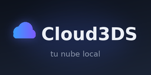
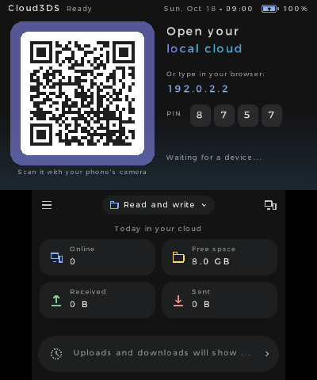
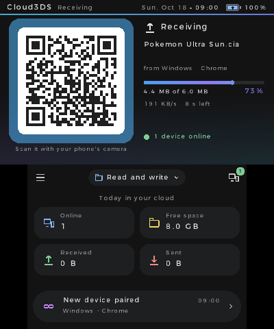
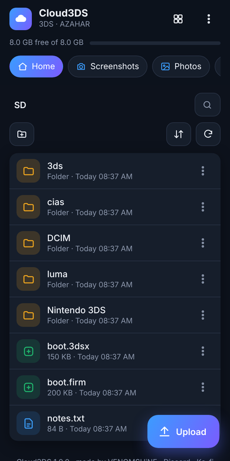
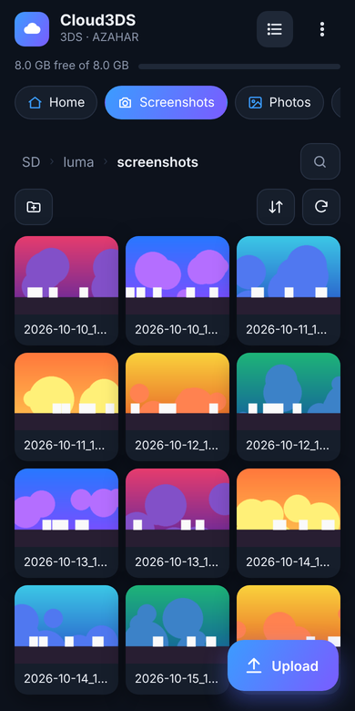
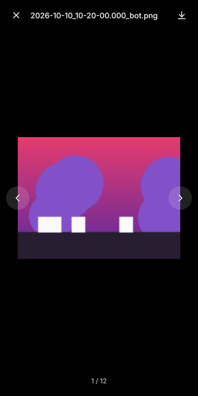
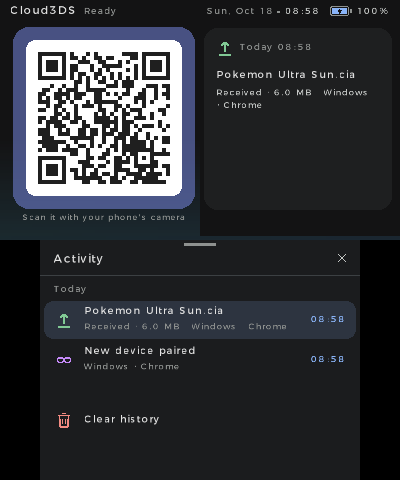
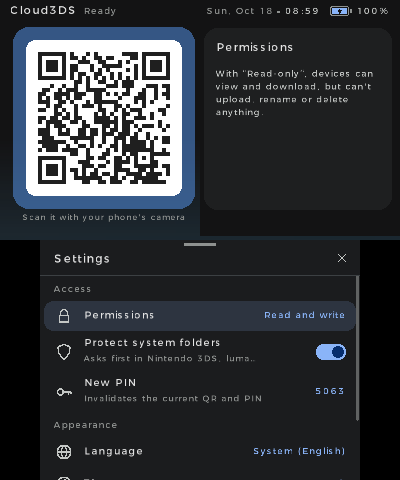
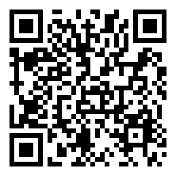

<p align="center"></p>

<h1 align="center">Cloud3DS</h1>
<p align="center"><b>Tu nube local para Nintendo 3DS.</b><br>
Maneja la tarjeta SD de tu consola desde el móvil o el PC: escanea un QR y listo. Sin apps, sin cables y sin configurar nada.</p>

<p align="center">


</p>

<p align="center">




</p>

## ¿Por qué no FTPD?

FTPD funciona, pero hay que instalar un cliente FTP, escribir la IP y el puerto a mano y leer texto plano en la consola. Cloud3DS hace lo mismo y más, desde **cualquier navegador**:

- **Conectar en un segundo:** escanea el QR de la consola con la cámara del móvil y se abre tu SD. En el PC escribes la dirección y el PIN de 4 cifras que aparecen en pantalla.
- **Dispositivos recordados:** cada móvil o PC vinculado se queda guardado. Lo ves en la consola y lo puedes expulsar cuando quieras.
- **Subir arrastrando:** archivos sueltos o carpetas enteras, con cola, velocidad y tiempo restante. Si un archivo ya existe, te pregunta si quieres reemplazarlo, conservar ambos u omitirlo.
- **Accesos rápidos:** Capturas (Luma), Fotos (cámara), CIAs, Homebrew y Partidas (Checkpoint).
- **Visor integrado:** fotos y capturas (deslizando entre ellas), vídeos y archivos de texto.
- **Gestión completa:** crear carpetas, renombrar, borrar (también varios a la vez), buscar y ordenar por nombre, fecha o tamaño.
- **Seguro por defecto:** PIN nuevo en cada arranque, bloqueo tras varios intentos fallidos, modo **solo lectura** y confirmación antes de tocar carpetas del sistema (`Nintendo 3DS`, `luma/payloads`, `boot.firm`…).
- **Sin sorpresas:** las subidas se escriben en un temporal y solo se renombran al terminar. Si se corta la conexión, no quedan archivos a medias. Avisa si no hay espacio o si el archivo pasa de 4 GB (límite de FAT32).
- **Puedes cerrar la tapa:** mientras transfiere, la consola no se suspende y apaga la pantalla.
- **En la consola:** el QR, la dirección y el PIN siempre a la vista, con las transferencias en directo al lado. Resumen del día, actividad, dispositivos conectados, permisos y ajustes en menús con el mismo estilo que [Gemi3DS](https://github.com/venomshine/Gemi3DS). Tema oscuro o claro, en español, inglés y japonés.

<p align="center"> </p>
<p align="center"></p>

## Instalar



**Con FBI (sin cables):** abre FBI → *Remote Install* → *Scan QR Code* y escanea este QR. Instala siempre la última versión.

**A mano:** descarga `Cloud3DS.cia` desde [Releases](https://github.com/venomshine/Cloud3DS/releases) e instálalo con FBI, o copia `Cloud3DS.3dsx` a `sdmc:/3ds/` y ábrelo desde el Homebrew Launcher.

## Cómo se usa

1. Conecta la consola a tu Wi-Fi (o al punto de acceso de tu móvil si no tienes router) y abre **Cloud3DS**.
2. Escanea el QR de la pantalla de arriba con el móvil, o escribe en el navegador del PC la dirección que aparece (por ejemplo `192.168.1.34`) y el PIN.
3. Listo: navega, sube, descarga y organiza.

El móvil o el PC tienen que estar en la **misma red** que la consola. En algunas Wi-Fi públicas los dispositivos no se pueden ver entre sí; ahí no funcionará.

## Controles en la consola

| Botón | Acción |
|---|---|
| X | Menú (actividad, dispositivos, ajustes, acerca de) |
| A | Actividad |
| Y | Dispositivos |
| R | Permisos (lectura y escritura o solo lectura) |
| Cruceta | Moverse por las listas |
| B | Cerrar (la pantalla de arriba vuelve al QR) |
| START | Salir |

Todo se puede hacer también con la pantalla táctil.

## Archivos en la SD

`sdmc:/3ds/Cloud3DS/` guarda `config.json` (ajustes, dispositivos e historial) y `net.log` (registro de diagnóstico). Si algo falla, ese registro ayuda mucho a encontrar el problema.

## Compilar

Necesitas [devkitPro](https://devkitpro.org) con `3ds-dev`:

```sh
make                      # Cloud3DS.3dsx
tools/build_cia.sh        # Cloud3DS.cia (necesita bannertool y makerom)
```

`tools/gen_i18n.py` regenera la tabla de traducciones a partir de `tools/i18n_tr.py`. `tools/gen_art.py` y `tools/gen_banner_wav.py` generan el icono, el banner y su sonido.

## Créditos y licencias

Hecho por **VENOMSHiNE** · [GitHub](https://github.com/venomshine) · [Discord](https://discord.com/invite/yVKp8JwV4e) · [Ko-fi](https://ko-fi.com/venomshine)

<a href="https://ko-fi.com/W3A028X2KV"></a>

Cloud3DS se distribuye bajo la licencia **GPL-3.0 con términos adicionales de atribución** (sección 7): ver [LICENSE](LICENSE) y [NOTICE.md](NOTICE.md). La interfaz de la consola está basada en [Gemi3DS](https://github.com/venomshine/Gemi3DS). Usa [libctru, citro2d y citro3d](https://github.com/devkitPro), [cJSON](https://github.com/DaveGamble/cJSON) y [QR Code generator](https://github.com/nayuki/QR-Code-generator).
