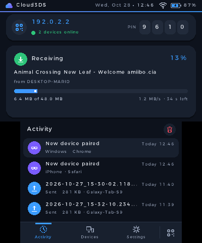

# Cloud3DS

**Tu nube local para Nintendo 3DS.** Maneja la tarjeta SD de tu consola desde el móvil o el PC: escanea un QR y listo. Sin apps, sin cables y sin configurar nada. Solo Plug-and-Play.

*English below · [Read in English](#english)*

<a href='https://ko-fi.com/W3A028X2KV' target='_blank'></a>

<p align="center">
  
  
  
</p>
<p align="center">
  
  
  
</p>
<p align="center">
  
  
</p>

## Descargar e instalar


**Instalar sin cables con FBI (recomendado)**
1. En la 3DS abre **FBI** → *Remote Install* → *Scan QR Code*.
2. Escanea el código QR de la derecha. Descarga siempre la última versión del `.cia`.
3. Cloud3DS aparece en el menú HOME.

**Instalar a mano**
- **`.cia`**: descarga `Cloud3DS.cia` de la [última versión](https://github.com/venomshine/Cloud3DS/releases/latest), cópialo a la SD e instálalo con FBI.
- **`.3dsx`**: copia `Cloud3DS.3dsx` a `sd:/3ds/` y ábrelo desde el Homebrew Launcher.

Necesitas una consola con homebrew (por ejemplo, con [3ds.hacks.guide](https://3ds.hacks.guide/)) y conexión Wi-Fi. Funciona en 3DS, 2DS, New 3DS y New 2DS.

## Cómo se usa

1. Conecta la consola a tu Wi-Fi (o al punto de acceso de tu móvil si no tienes router) y abre **Cloud3DS**.
2. **Desde el móvil:** escanea el QR de la pantalla de arriba con la cámara. Se abre tu SD en el navegador, sin escribir nada.
3. **Desde el PC:** escribe en el navegador la dirección que aparece (por ejemplo `192.168.1.34`) y el **PIN** de 4 cifras.
4. Listo: navega, sube, descarga y organiza. Cada dispositivo queda recordado; la próxima vez entra solo.

**Actualizaciones:** Cloud3DS busca versiones nuevas al abrirse. Cuando haya una, ve a **Ajustes → Actualizaciones** y pulsa **Actualizar**: la descarga, comprueba que es el archivo original y la instala, sin FBI ni cables.

El móvil o el PC tienen que estar en **la misma red** que la consola. En algunas Wi-Fi públicas los dispositivos no se pueden ver entre sí; ahí no funcionará. Todo se queda en tu red: nada pasa por Internet.

## Funciones

- **Conectar en un segundo:** QR en la consola para el móvil y dirección + PIN para el PC. El PIN es siempre el mismo para que te lo aprendas; puedes elegir el tuyo o pedir uno al azar en Ajustes. Tras varios intentos fallidos se bloquea un rato.
- **Dispositivos con su nombre real:** la consola lo pregunta a la red («Marios-iPhone», «DESKTOP-MARIO»), y si no lo encuentra se ve el modelo («iPhone · Safari»). Puedes renombrarlos desde la consola o desde la web, ver quién está conectado y **desvincular** a cualquiera; en su navegador aparece al momento.
- **Explorador de la SD** en el navegador: accesos rápidos a **Capturas** (Luma), **Fotos** (cámara), **CIAs**, **Homebrew** y **Partidas** (las copias de Checkpoint o JKSM); lista o cuadrícula con miniaturas; búsqueda y orden por nombre, fecha o tamaño.
- **Carpetas destacadas:** marca cualquier carpeta con uno de seis colores para encontrarla enseguida; sale la primera. Las **carpetas del sistema** van aparte, en su propio grupo plegable.
- **Subir arrastrando** archivos sueltos o carpetas enteras, con cola, progreso, velocidad y tiempo restante.
- **Copiar y mover** archivos y carpetas dentro de la SD, también varios a la vez, eligiendo el destino en un selector de carpetas.
- **Si algo ya existe**, eliges: **reemplazar** (o **combinar**, si es una carpeta), **renombrar**, **conservar ambos**, **omitir** o **cancelar todo**, y puedes aplicarlo a todos de una vez.
- **Descargar** archivos y ver **fotos** (deslizando entre ellas), **vídeos** y **textos** directamente en el navegador.
- **Crear carpetas, renombrar y borrar**, también varios a la vez.
- **Seguro por defecto:** modo **solo lectura** y **carpetas del sistema protegidas** (`Nintendo 3DS`, `3ds`, `luma`, `boot.firm`…): llevan un candado y no se pueden borrar ni renombrar mientras la protección esté activa.
- **Sin sorpresas:** las subidas y las copias se escriben en un temporal y solo se guardan al terminar; si se corta, no quedan archivos a medias. Avisa si no hay espacio o si el archivo pasa de 4 GB (límite de FAT32).
- **En la consola:** el QR, la dirección y el PIN siempre a la vista, con las transferencias en directo al lado. Con **SELECT** el QR se minimiza y deja la pantalla de arriba libre. Pestañas de **Actividad**, **Dispositivos** y **Ajustes**; en «Acerca de», los QR de GitHub, Discord y Ko-fi.
- **Se actualiza sola:** busca versiones nuevas en GitHub y las instala desde Ajustes, comprobando antes que el archivo es el original (SHA-256). Nunca baja de versión.
- **Puedes cerrar la tapa:** mientras transfiere, la consola no se suspende y apaga la pantalla.
- Fecha, hora, Wi-Fi y batería en la pantalla superior. Tema oscuro y claro.
- Idiomas: **español, inglés y japonés** (o el de la consola). La web usa el idioma del móvil o del PC.

## Controles

| Botón | Acción |
|---|---|
| **L / R** | Cambiar de pestaña (Actividad, Dispositivos, Ajustes) |
| **↑ ↓** | Moverse por las listas |
| **A** | Elegir (en Dispositivos: renombrar) |
| **X** | Desvincular el dispositivo elegido (en Dispositivos) |
| **Y** | Borrar el historial (en Actividad) |
| **B** | Atrás / cancelar |
| **SELECT** | Minimizar o abrir el QR (también con el botón del QR, abajo a la derecha) |
| **START** | Salir (siempre pregunta) |

Todo se puede hacer también con la pantalla táctil.

## Errores y sugerencias

¿Algo falla o se ve raro? Abre un [issue](https://github.com/venomshine/Cloud3DS/issues) o escríbeme en [Discord](https://discord.com/invite/yVKp8JwV4e). Si algo falla en la red, el archivo `sd:/3ds/Cloud3DS/net.log` ayuda mucho a encontrar el problema. Si quieres apoyar el proyecto, invítame a un café:

<a href='https://ko-fi.com/W3A028X2KV' target='_blank'></a>

## Compilar desde el código

1. Instala [devkitPro](https://devkitpro.org/wiki/Getting_Started) con el paquete *3DS Development*.
2. Compila:
   ```
   dkp-pacman -S 3ds-dev 3ds-curl 3ds-mbedtls
   make
   ```
   Se genera `Cloud3DS.3dsx`.
3. Para el `.cia`, pon [`bannertool`](https://github.com/carstene1ns/3ds-bannertool) y [`makerom`](https://github.com/3DSGuy/Project_CTR) en el PATH y ejecuta `make cia`. También genera `Cloud3DS.sha256`, que se sube a la release junto al `.cia` y el `.3dsx`: la app lo usa para comprobar las actualizaciones.

```
source/   código de la app
  main.c          arranque, bucle principal e interfaz de la consola
  server.c        servidor web: la página y la API de archivos
  fsx.c           operaciones de la SD
  ops.c           copiar y mover dentro de la SD
  names.c         nombre real de los dispositivos (mDNS, NetBIOS y el router)
  update.c        buscar e instalar actualizaciones desde GitHub
  state.c         estado compartido, dispositivos, historial y configuración
  gfx.c ui.c icons.c   gráficos, componentes e íconos
  i18n.c          idiomas (la tabla i18n_table.h se genera con tools/gen_i18n.py)
web/      página web (se sirve comprimida desde romfs)
lib/      cJSON, QR Code generator
romfs/    certificados raíz de Mozilla para HTTPS
cia/      icono, banner, sonido y configuración del .cia
tools/    traducciones, icono y banner, sonido del banner y empaquetado del .cia
tests/    pruebas automáticas en el emulador (API, web y capturas)
```

Para añadir o corregir traducciones, edita `tools/i18n_tr.py` y ejecuta `python3 tools/gen_i18n.py`.

---

## English

**Your local cloud for Nintendo 3DS.** Manage your console's SD card from your phone or PC: scan a QR code and you're in. No apps, no cables, nothing to set up — an easy alternative to FTPD. The interface is available in Spanish, English and Japanese.

**Install:** open **FBI** → *Remote Install* → *Scan QR Code* and scan the QR above, or download `Cloud3DS.cia` / `Cloud3DS.3dsx` from the [latest release](https://github.com/venomshine/Cloud3DS/releases/latest).

**Use:** open Cloud3DS with the console on Wi-Fi. Scan the QR code with your phone's camera, or type the address and PIN shown on the console in your PC's browser (same network). Browse, upload (drag and drop files or whole folders), download, copy and move, view photos and videos, rename and delete. If something already exists, choose to replace (or merge folders), rename, keep both, skip or cancel all. Highlight folders with a color, and system folders are shown in their own group. Devices show their real name when the network provides it, can be renamed and unpaired from the console. Press SELECT to minimize the QR card. The PIN stays the same until you change it (pick your own in Settings). Read-only mode and system-folder protection are on hand, and uploads and copies never leave half-written files behind.

**Updates:** Cloud3DS checks GitHub for new versions when it opens. Go to **Settings → Updates** to download, verify (SHA-256) and install the new one without FBI.

**Build:** devkitPro with `3ds-dev 3ds-curl 3ds-mbedtls`, then `make` (or `make cia` with bannertool and makerom, which also creates `Cloud3DS.sha256` for the release).

Bugs and ideas: [issues](https://github.com/venomshine/Cloud3DS/issues) or [Discord](https://discord.com/invite/yVKp8JwV4e).

---

Hecho por **VENOMSHiNE** · [GitHub](https://github.com/venomshine) · [Discord](https://discord.com/invite/yVKp8JwV4e) · [Ko-fi](https://ko-fi.com/venomshine)

Cloud3DS es un proyecto no oficial y no está afiliado a Nintendo. *Cloud3DS is an unofficial project, not affiliated with Nintendo.*

## Licencia

Cloud3DS es software libre bajo la **[GNU GPL v3](LICENSE)** con términos adicionales de atribución ([NOTICE.md](NOTICE.md)):

- Puedes usar, estudiar y modificar el código, pero lo que hagas con él también debe ser de código abierto bajo la GPL-3.0.
- **Debes dar crédito visible** en tu README y en la pantalla de créditos o «Acerca de» de tu app:
  > Basado en Cloud3DS de VENOMSHiNE — https://github.com/venomshine/Cloud3DS
- No puedes presentarlo como tuyo, y las versiones modificadas deben indicar que lo son.

*License: GNU GPL v3 with additional attribution terms — see [NOTICE.md](NOTICE.md).*

Incluye cJSON (MIT), QR Code generator de Project Nayuki (MIT), libcurl (curl), Mbed TLS (Apache-2.0) y los certificados raíz de Mozilla (MPL-2.0), que conservan sus licencias.
