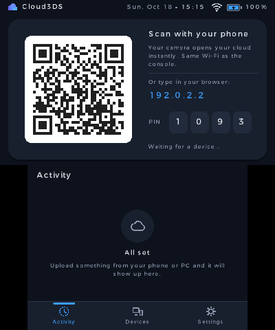
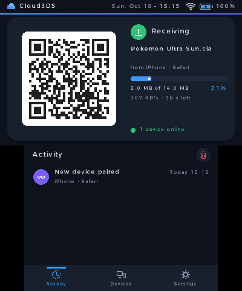
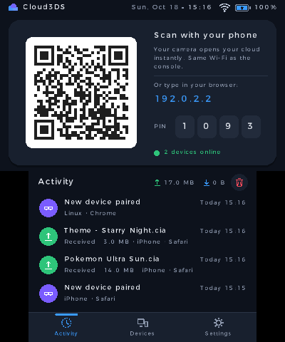
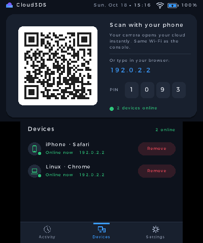
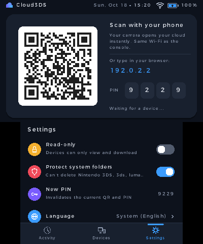
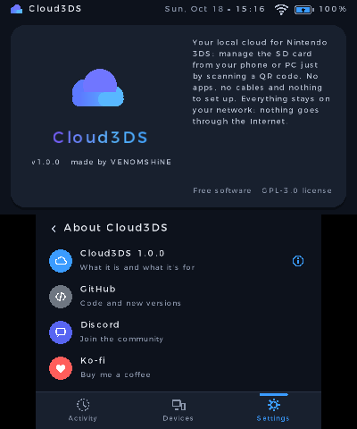
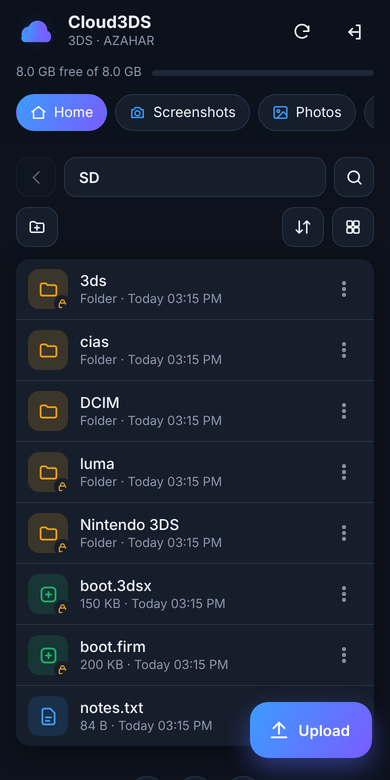
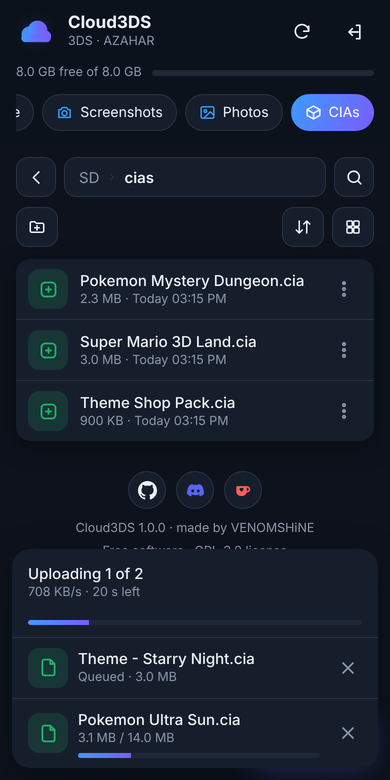
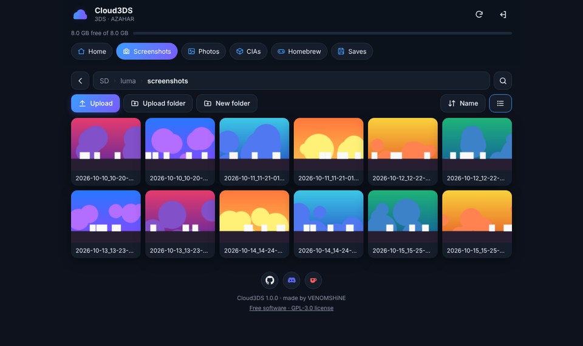
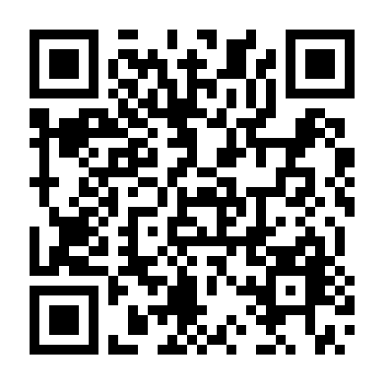

# Cloud3DS

**Tu nube local para Nintendo 3DS.** Maneja la tarjeta SD de tu consola desde el móvil o el PC: escanea un QR y listo. Sin apps, sin cables y sin configurar nada; una alternativa a FTPD pensada para que cualquiera la use.

*English below · [Read in English](#english)*

<a href='https://ko-fi.com/W3A028X2KV' target='_blank'></a>

<p align="center">
  
  
  
</p>
<p align="center">
  
  
  
</p>
<p align="center">
  
  
  
</p>

## Descargar e instalar



**Instalar sin cables con FBI (recomendado)**
1. En la 3DS abre **FBI** → *Remote Install* → *Scan QR Code*.
2. Escanea el código QR de la derecha. Descarga siempre la última versión del `.cia`.
3. Cloud3DS aparece en el menú HOME.

**Instalar a mano**
- **`.cia`**: descarga `Cloud3DS.cia` de la [última versión](https://github.com/venomshine/Cloud3DS/releases/latest), cópialo a la SD e instálalo con FBI.
- **`.3dsx`**: copia `Cloud3DS.3dsx` a `sd:/3ds/` y ábrelo desde el Homebrew Launcher.

Necesitas una consola con homebrew (por ejemplo, con [3ds.hacks.guide](https://3ds.hacks.guide/)) y conexión Wi-Fi. Funciona en 3DS, 2DS, New 3DS y New 2DS.

## Cómo se usa

1. Conecta la consola a tu Wi-Fi (o al punto de acceso de tu móvil si no tienes router) y abre **Cloud3DS**.
2. **Desde el móvil:** escanea el QR de la pantalla de arriba con la cámara. Se abre tu SD en el navegador, sin escribir nada.
3. **Desde el PC:** escribe en el navegador la dirección que aparece (por ejemplo `192.168.1.34`) y el **PIN** de 4 cifras.
4. Listo: navega, sube, descarga y organiza. Cada dispositivo queda recordado; la próxima vez entra solo.

El móvil o el PC tienen que estar en **la misma red** que la consola. En algunas Wi-Fi públicas los dispositivos no se pueden ver entre sí; ahí no funcionará. Todo se queda en tu red: nada pasa por Internet.

## Funciones

- **Conectar en un segundo:** QR en la consola para el móvil y dirección + PIN para el PC. El PIN cambia en cada arranque y se bloquea tras varios intentos fallidos.
- **Dispositivos recordados:** los ves en la consola, con quién está conectado ahora, y puedes **expulsar** a cualquiera; en su navegador aparece al momento que lo desconectaron.
- **Explorador de la SD** en el navegador: accesos rápidos a **Capturas** (Luma), **Fotos** (cámara), **CIAs**, **Homebrew** y **Partidas** (Checkpoint); lista o cuadrícula con miniaturas; búsqueda y orden por nombre, fecha o tamaño.
- **Subir arrastrando** archivos sueltos o carpetas enteras, con cola, progreso, velocidad y tiempo restante. Si algo ya existe, eliges **reemplazar**, **conservar ambos** u **omitir**.
- **Carpeta anterior**, ruta siempre visible y **búsqueda** que se despliega desde la lupa.
- **Descargar** archivos y ver **fotos** (deslizando entre ellas), **vídeos** y **textos** directamente en el navegador.
- **Crear carpetas, renombrar y borrar**, también varios a la vez.
- **Seguro por defecto:** modo **solo lectura** y **carpetas del sistema protegidas** (`Nintendo 3DS`, `3ds`, `luma`, `boot.firm`…): llevan un candado y no se pueden borrar ni renombrar mientras la protección esté activa.
- **Sin sorpresas:** las subidas se escriben en un temporal y solo se guardan al terminar; si se corta la conexión, no quedan archivos a medias. Avisa si no hay espacio o si el archivo pasa de 4 GB (límite de FAT32).
- **En la consola:** el QR, la dirección y el PIN siempre a la vista, con las transferencias en directo al lado. Pestañas de **Actividad**, **Dispositivos** y **Ajustes**; en «Acerca de», los QR de GitHub, Discord y Ko-fi.
- **Puedes cerrar la tapa:** mientras transfiere, la consola no se suspende y apaga la pantalla.
- Fecha, hora, Wi-Fi y batería en la pantalla superior. Tema oscuro y claro.
- Idiomas: **español, inglés y japonés** (o el de la consola). La web usa el idioma del móvil o del PC.

## Controles

| Botón | Acción |
|---|---|
| **L / R** | Cambiar de pestaña (Actividad, Dispositivos, Ajustes) |
| **↑ ↓** | Moverse por las listas |
| **A** | Elegir |
| **Y** | Borrar el historial (en Actividad) |
| **B** | Atrás / cancelar |
| **START** | Salir |

Todo se puede hacer también con la pantalla táctil.

## Errores y sugerencias

¿Algo falla o se ve raro? Abre un [issue](https://github.com/venomshine/Cloud3DS/issues) o escríbeme en [Discord](https://discord.com/invite/yVKp8JwV4e). Si algo falla en la red, el archivo `sd:/3ds/Cloud3DS/net.log` ayuda mucho a encontrar el problema. Si quieres apoyar el proyecto, invítame a un café:

<a href='https://ko-fi.com/W3A028X2KV' target='_blank'></a>

## Compilar desde el código

1. Instala [devkitPro](https://devkitpro.org/wiki/Getting_Started) con el paquete *3DS Development*.
2. Compila:
   ```
   dkp-pacman -S 3ds-dev
   make
   ```
   Se genera `Cloud3DS.3dsx`.
3. Para el `.cia`, pon [`bannertool`](https://github.com/carstene1ns/3ds-bannertool) y [`makerom`](https://github.com/3DSGuy/Project_CTR) en el PATH y ejecuta `make cia`.

```
source/   código de la app
  main.c          arranque, bucle principal e interfaz de la consola
  server.c        servidor web: la página y la API de archivos
  fsx.c           operaciones de la SD
  state.c         estado compartido, dispositivos, historial y configuración
  gfx.c ui.c icons.c   gráficos, componentes e íconos
  i18n.c          idiomas (la tabla i18n_table.h se genera con tools/gen_i18n.py)
web/      página web (se sirve comprimida desde romfs)
lib/      cJSON, QR Code generator
cia/      icono, banner, sonido y configuración del .cia
tools/    traducciones, icono y banner, sonido del banner y empaquetado del .cia
tests/    pruebas automáticas en el emulador (API, web y capturas)
```

Para añadir o corregir traducciones, edita `tools/i18n_tr.py` y ejecuta `python3 tools/gen_i18n.py`.

---

## English

**Your local cloud for Nintendo 3DS.** Manage your console's SD card from your phone or PC: scan a QR code and you're in. No apps, no cables, nothing to set up — an easy alternative to FTPD. The interface is available in Spanish, English and Japanese.

**Install:** open **FBI** → *Remote Install* → *Scan QR Code* and scan the QR above, or download `Cloud3DS.cia` / `Cloud3DS.3dsx` from the [latest release](https://github.com/venomshine/Cloud3DS/releases/latest).

**Use:** open Cloud3DS with the console on Wi-Fi. Scan the QR code with your phone's camera, or type the address and PIN shown on the console in your PC's browser (same network). Browse, upload (drag and drop files or whole folders), download, view photos and videos, rename and delete. Devices are remembered and can be removed from the console. Read-only mode and system-folder protection are on hand, and uploads never leave half-written files behind.

**Build:** devkitPro with `3ds-dev`, then `make` (or `make cia` with bannertool and makerom).

Bugs and ideas: [issues](https://github.com/venomshine/Cloud3DS/issues) or [Discord](https://discord.com/invite/yVKp8JwV4e).

---

Hecho por **VENOMSHiNE** · [GitHub](https://github.com/venomshine) · [Discord](https://discord.com/invite/yVKp8JwV4e) · [Ko-fi](https://ko-fi.com/venomshine)

Cloud3DS es un proyecto no oficial y no está afiliado a Nintendo. *Cloud3DS is an unofficial project, not affiliated with Nintendo.*

## Licencia

Cloud3DS es software libre bajo la **[GNU GPL v3](LICENSE)** con términos adicionales de atribución ([NOTICE.md](NOTICE.md)):

- Puedes usar, estudiar y modificar el código, pero lo que hagas con él también debe ser de código abierto bajo la GPL-3.0.
- **Debes dar crédito visible** en tu README y en la pantalla de créditos o «Acerca de» de tu app:
  > Basado en Cloud3DS de VENOMSHiNE — https://github.com/venomshine/Cloud3DS
- No puedes presentarlo como tuyo, y las versiones modificadas deben indicar que lo son.

*License: GNU GPL v3 with additional attribution terms — see [NOTICE.md](NOTICE.md).*

Incluye cJSON (MIT) y QR Code generator de Project Nayuki (MIT), que conservan sus licencias.
